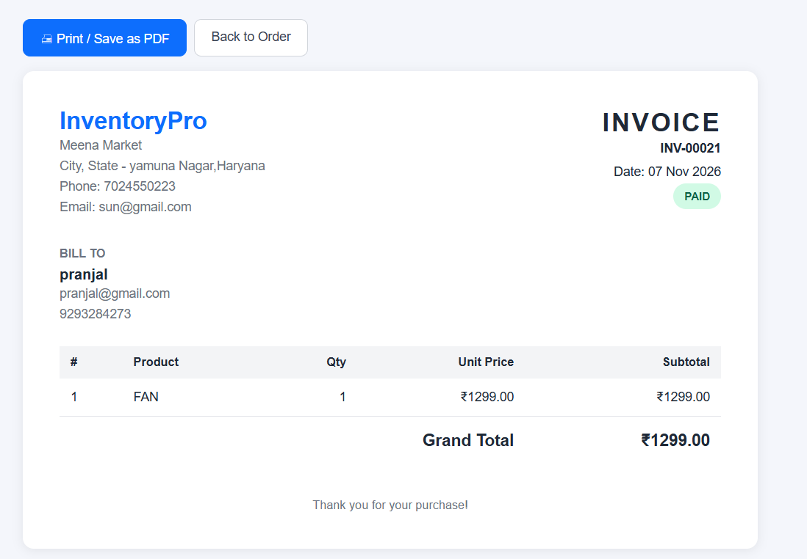
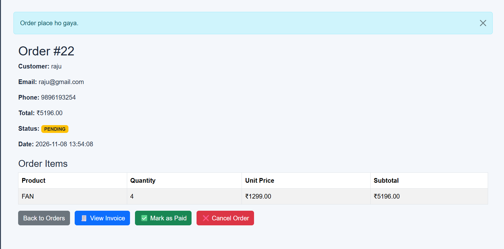

# Inventory & Sales Management System

A Flask + MySQL web app to manage products, stock, sales and customer orders, with a live dashboard and reports.

## Features
- Product catalog with search, category filter and sorting
- Stock management: restock, stock history, sales recording
- Orders: Pending → Paid / Cancelled, with automatic stock handling
- Printable invoices
- Dashboard (Chart.js): 7-day revenue trend, top-selling products
- Reports with CSV export

## Tech Stack
Python, Flask, MySQL, Bootstrap, Chart.js, Flask-WTF

## Screenshots

### Dashboard

### Products and Catalog

### Orders and Invoice

### Sales and Stock

### Reports

### order pass

## Security & Reliability
- CSRF protection on all POST forms
- Secrets in .env (not committed)
- Server-side input validation
- DB transactions with row locking (SELECT ... FOR UPDATE) so concurrent cancel/pay requests cannot corrupt stock

## Setup
1. Clone the repo and create a virtual environment:
   python -m venv venv
   .\venv\Scripts\Activate.ps1
2. Install dependencies:
   python -m pip install -r requirements.txt
3. Create the database and tables:
   mysql -u root -p < schema.sql
4. Copy `.env.example` to `.env` and fill in your values.
5. Run:
   python app.py

## Project Structure
(short folder list)

## Future Improvements
- Razorpay payment integration
- Automated tests
- Role-based login